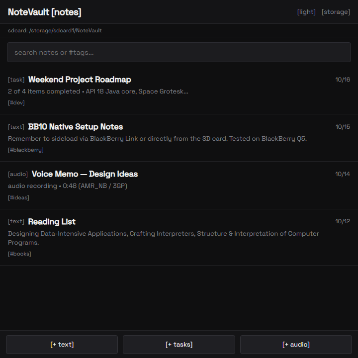
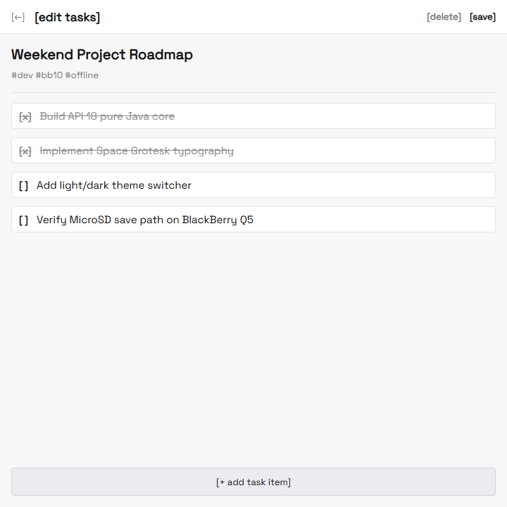

# NoteVault (BB10)

> A clean, minimalist, offline note-taking app designed for BlackBerry 10 devices (Q10, Q5, Classic, Passport) running the Android 4.3 runtime (API 18).

<p align="center">
  
  &nbsp;&nbsp;
  
</p>
<p align="center"><em>Dark Mode (Notes & Audio) &nbsp;&bull;&nbsp; Light Mode (Task Editor)</em></p>

---

## ⚡ Quick Readme

- **Offline First**: All notes, checklists, and voice memos are stored locally. No accounts, no cloud sync, no tracking.
- **MicroSD Card Support**: Saves notes directly to your external MicroSD card (`/storage/sdcard1/NoteVault`) to preserve phone storage.
- **Square Screen Optimized**: Tailored specifically for the 720×720 square display on BlackBerry Q5 / Q10 / Classic.
- **Physical Keyboard Friendly**: Seamless navigation with space for your keyboard.
- **Lightweight**: Pure Android SDK (API 18) with zero AndroidX or heavy background libraries. Instant launch times and minimal battery drain.

---

## 🛠️ Features

- 📝 **Text Notes**: Fast note taking with automatic timestamps and tag filtering (`#tag`).
- ☑️ **Task Lists**: Interactive to-do lists with checkbox support and progress indicators.
- 🎙️ **Audio Notes**: Record voice memos saved in `.3gp` / `AMR_NB` format with playback.
- 💾 **Smart Storage Engine**: 4-stage fallback (Custom path → SD Card `/storage/sdcard1` → External Storage → Internal app storage).
- 🌓 **Monochrome Aesthetic**: Minimalist, distraction-free monochrome styling with `[bracket]` conventions.
- 🔲 **Theme Switcher**: Instant `[light]` / `[dark]` mode toggle.
- 🔤 **Space Grotesk Typography**: Custom embedded font styled after clean typographic web design.

---

## 📦 Version History & Releases

Download sideloadable APKs directly from the [Releases page](https://github.com/warumpas-ops/notevault-bb10/releases):

| Version | Title | Status | Download |
|:---|:---|:---|:---|
| **[v1.1.0](https://github.com/warumpas-ops/notevault-bb10/releases/tag/v1.1.0)** | **NoteVault v1.1.0 (Auto Storage)** — Auto-creates `NoteVault` folder on MicroSD & Phone storage root, auto-migrates legacy notes. | 🟢 Latest | [⬇️ NoteVault-v1.1.0.apk](https://github.com/warumpas-ops/notevault-bb10/releases/download/v1.1.0/NoteVault-v1.1.0.apk) |
| **[v1.0.0](https://github.com/warumpas-ops/notevault-bb10/releases/tag/v1.0.0)** | **NoteVault v1.0.0 (Base Milestone)** — Original base release with custom `[ N ]` squircle icon, Space Grotesk UI, light/dark themes. | 🟢 Milestone | [⬇️ NoteVault.apk](https://github.com/warumpas-ops/notevault-bb10/releases/download/v1.0.0/NoteVault.apk) |
| **[v0.2.0](https://github.com/warumpas-ops/notevault-bb10/releases/tag/v0.2.0)** | **NoteVault v0.2.0 (UI Overhaul)** — Space Grotesk font, monochrome palette, bracket UI style, and theme toggle. | 🟡 Pre-release | [⬇️ NoteVault-v0.2.0-beta.apk](https://github.com/warumpas-ops/notevault-bb10/releases/download/v0.2.0/NoteVault-v0.2.0-beta.apk) |
| **[v0.1.0](https://github.com/warumpas-ops/notevault-bb10/releases/tag/v0.1.0)** | **NoteVault v0.1.0 (Prototype)** — The first working test build before the redesign. | 🔴 Deprecated | [⬇️ NoteVault-v0.1.0-prototype.apk](https://github.com/warumpas-ops/notevault-bb10/releases/download/v0.1.0/NoteVault-v0.1.0-prototype.apk) |

---

## 📲 How to Sideload onto BlackBerry 10

1. Download **`NoteVault.apk`** from [v1.0.0 Release](https://github.com/warumpas-ops/notevault-bb10/releases/tag/v1.0.0).
2. Transfer the APK to your BlackBerry via USB or copy it directly to your MicroSD card.
3. Open the **File Manager** app on your BB10 device.
4. Locate `NoteVault.apk`, tap to open, and tap **Install** in the top-right corner.

---

## 🏗️ Building from Source

Targeting Android API 18 with Java 8:

```bash
./gradlew assembleDebug
```

The output APK will be placed in `app/build/outputs/apk/debug/app-debug.apk`.
